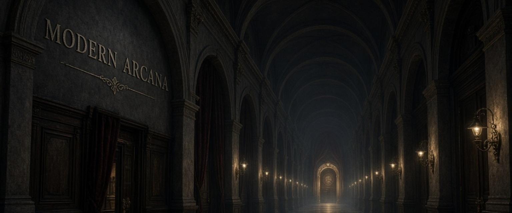

 
Gmorkz

Independent developer · Experimental game design · Systems and storytelling

---

◇ CURRENTLY BUILDING

MODERN ARCANA

An experimental interactive game exploring institutional absurdity, tactical decisions and consequences.

A world where bureaucracy becomes architecture, rules become mechanics, and every decision has the potential to matter.

Current priorities

- Stability and reliability
- Cleaner underlying architecture
- Persistence between floors
- Strategic card gameplay
- World-building and atmosphere

---

◇ DESIGN PHILOSOPHY

- Preserve unusual ideas rather than sanding them down.
- Test before making changes.
- Make decisions carry consequences.
- Prioritise atmosphere, originality and meaningful mechanics.
- Build deliberately. Improve incrementally.

---

◇ APPROACH

I prefer projects with a distinct identity over projects that simply follow a familiar formula.

Experimentation is encouraged. Unnecessary complexity is not.

The aim is to make something memorable, coherent and worth exploring.

---

◇ A NOTE FROM THE DEVELOPER

Usually overthinking something.

Occasionally making progress.

Generally suspicious of anything described as a simple solution.

---

End of shift. Probably not the end of the story.

- Preserve what makes an idea interesting.
- Test before changing what already works.
- Let decisions have consequences.
- Prefer atmosphere and originality over convention.
- Build deliberately. There's no point creating a problem just to enjoy solving it.

---

A NOTE FROM THE DEVELOPER

I make things, occasionally overthink them, and then make them anyway.

Some projects are experiments. Some become considerably more complicated than expected.

Modern Arcana is currently somewhere in between.

---

End of shift. Probably not the end of the story.
